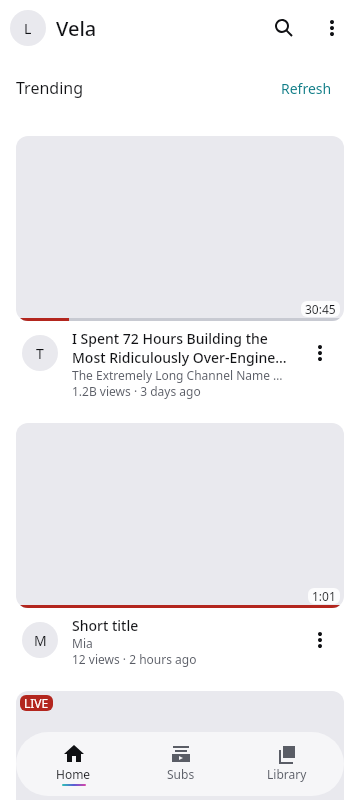
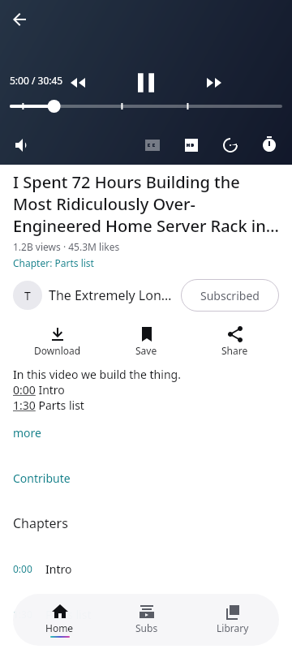
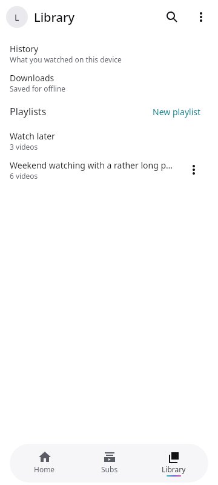
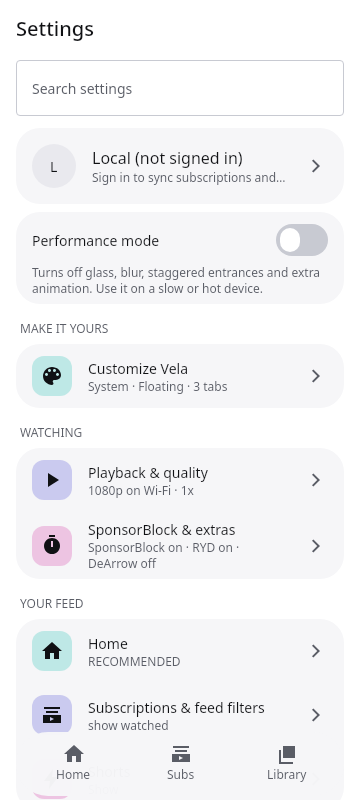
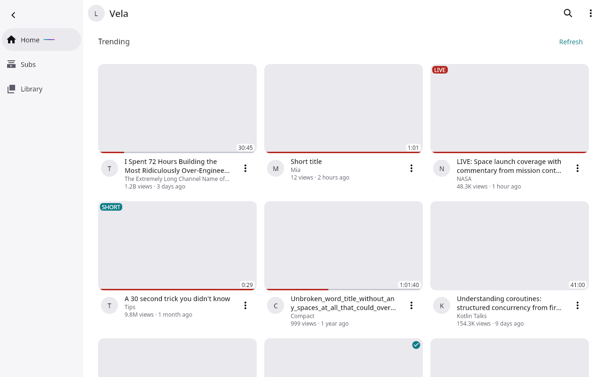
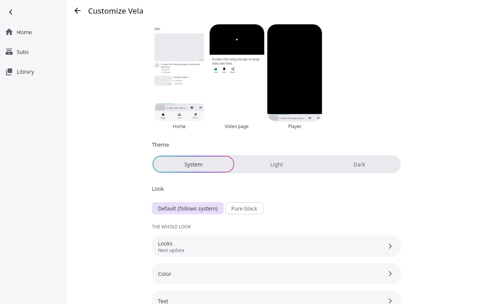

# Vela

A YouTube client for Android and the desktop that keeps working. Every video can come from several sources, tried in order (anonymous first, your account last),
your subscriptions, history, playlists and downloads stay on your device, and the whole look (colours, icons, shapes, bars) is yours to change.

> **Beta (0.1.0-beta.3).** Android is the primary platform and Linux is supported. **Windows is experimental** (see below).

| | | |
|---|---|---|
|  |  |  |
|  |  |  |

*(Screens of the test build with sample data; the interface evolves between betas.)*

## Disclaimer

Vela is an independent project. It is **not affiliated with, endorsed by or connected to YouTube or Google.** Using a third-party client may go against YouTube's
terms of service; **use is at your own risk**, and an account you sign in with could be limited or closed. Vela never uses third-party "solver" services.
Accounts are optional and used last: the default is "only on failure", with pacing, budgets and a kill switch (see [docs/SPEC.md](docs/SPEC.md) section 4 and
[docs/reports/14-reliability.md](docs/reports/14-reliability.md)). **Use a throwaway account** for testing.

## Features

- **Watching**: Home, Explore, search for videos, channels and playlists, channels with all their tabs, playlists, Shorts, live streams and chat, chapters, captions, audio tracks, speed, sleep timer, autoplay, mini player, picture-in-picture. SponsorBlock, Return YouTube Dislike and DeArrow as switchable modules.
- **Reliability chain**: anonymous NewPipeExtractor, an alternate client, yt-dlp, then your account; it remembers what works, shows which source served each video and runs health checks. Signed remote configuration can retune client profiles without a new build.
- **Accounts and safety**: optional Google accounts (several), credentials in the platform secret store, a governor that paces and budgets every account request, a kill switch.
- **Offline**: downloads (quality, queue, storage cap), automatic download rules, per-account local history, subscriptions and playlists, backup and restore.
- **Customisation**: colour palettes, light/dark/pure black, icon packs, corner radius, glass, bar styles, choosable tabs, performance mode.
- **Keyboard**: shortcuts for playback and navigation, media keys (MPRIS) on Linux.

## Platforms

| Platform | Status | Package |
|---|---|---|
| Android 7.0+ (arm64) | Primary | APK (sideload) |
| Linux x86_64 | Supported | `.deb`, `.rpm`, portable `.tar.gz` |
| Windows 10/11 x64 | **Experimental**: packaged and smoke-tested, not feature-complete | `.msi`, portable `.zip` |

## Install

Download from the [Releases](../../releases) page and **verify the checksum** against `SHA256SUMS` (`sha256sum -c SHA256SUMS --ignore-missing`). Release files also carry build provenance attestations (`gh attestation verify <file> --repo <owner>/<repo>`).

- **Android**: allow installing from your browser/files app, open the `.apk`. Updates are only possible between builds signed with the same key. A file named `-unsigned` is a development build and cannot be updated over a signed one.
- **Linux (.deb, Debian/Ubuntu)**: `sudo apt install ./Vela-<version>-linux-amd64.deb`. It needs `libmpv2` (Ubuntu 24.04+, Debian 12+); on Ubuntu 22.04 install `libmpv1` instead and ignore the unmet dependency with `sudo dpkg -i --ignore-depends=libmpv2 ...`.
- **Linux (.rpm, Fedora)**: `sudo dnf install ./Vela-<version>-linux-x86_64.rpm` (pulls `mpv-libs`).
- **Linux (portable)**: unpack the `.tar.gz`, run `Vela-<version>/bin/vela`. Install libmpv yourself (`mpv-libs` / `libmpv2`).
- Recommended on Linux: `ffmpeg` (merging downloads) and `libsecret`/`secret-tool` (credential storage; without it an encrypted file is used). yt-dlp is found on your system or managed by the app.
- **Windows (experimental)**: run the `.msi` (per-user) or unpack the `.zip` and run `vela.exe`. See the list of gaps below.

### First run

- yt-dlp: on desktop the app uses the newest it finds, or can keep its own copy up to date (Settings > Updates). On Android it is built in.
- Age-restricted videos are **off** by default; enable them in Settings > Account safety if you want them (they may need an account).
- Nothing is sent to an account until you sign in; "Local" mode keeps everything on the device.

### Windows (experimental): known gaps

- Playback needs `libmpv-2.dll`. The official release files include a pinned build next to the app; if you built from source, put `libmpv-2.dll` next to `vela.exe` or on `PATH` (see [docs/BUILDING.md](docs/BUILDING.md)). Without it the app runs but cannot play.
- Account credentials are stored with Windows DPAPI (per user). If DPAPI is unavailable, signing in is disabled rather than storing anything unprotected.
- No media keys / system media controls (MPRIS is Linux-only), no desktop notifications for downloads, no `ffmpeg` bundled (install it to merge downloads).
- The yt-dlp updater uses the `yt-dlp.exe` asset (checksum verified) but has had little real-world testing; the installer is not code-signed, so SmartScreen will warn.
- Compared with Android and Linux it has had far less testing; expect rough edges.

## Build from source

```
git clone <this repository> && cd Vela
./gradlew :androidApp:assembleDebug      # Android (needs the Android SDK)
./gradlew :desktopApp:run                # desktop (needs libmpv)
```

Requirements, packaging, signing and Windows notes: [docs/BUILDING.md](docs/BUILDING.md). Releasing: [docs/RELEASING.md](docs/RELEASING.md).

## Tests

- `./gradlew allTests test`: all **offline** tests (this is what CI runs; it needs a display or `xvfb-run` for the UI tests).
- **Live** tests use the real network and real tools (NewPipe, yt-dlp, libmpv, a signed-in throwaway account) and are **never** part of CI: `./gradlew :extractor-newpipe:liveTest :extractor-ytdlp:liveTest` and the other modules' `liveTest` tasks. Account tests need `VELA_TEST_COOKIES` pointing at a cookies file of a throwaway account (kept outside the repository).

## Documentation

[docs/README.md](docs/README.md) is the index: the spec, the design notes, and a report for every piece of work (what was verified, what was not).

## Licence

Vela is free software under the **GNU General Public License v3.0 or later** (see [LICENSE](LICENSE)); it builds on NewPipeExtractor and youtubedl-android (GPL-3.0) and other open-source
components listed in [THIRD_PARTY_NOTICES.md](THIRD_PARTY_NOTICES.md). The About screen lists the main ones.

## Security

Report vulnerabilities privately: see [SECURITY.md](SECURITY.md). Contributing: [CONTRIBUTING.md](CONTRIBUTING.md).
