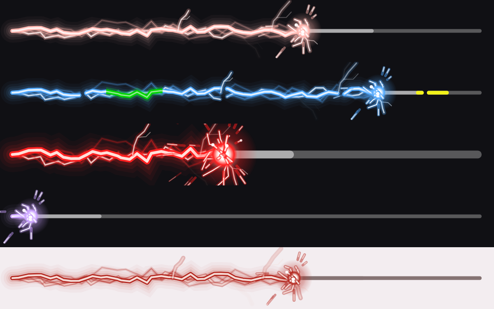

# 145 Lightning seek bar

## 1. Summary
New seek-bar style "Lightning" (Customize > Progress bar). The played part is a jagged bolt in the accent colour with a white-hot core, glow, three twisting strands, short-lived forks, a surge running up it every 2.2 s, a crackling head ball and falling sparks. Dragging overcharges it (wider bolt, more forks, arcs and sparks). The unplayed track, buffered span, chapters, SponsorBlock colours and scrubbing keep working.

Top to bottom: Vela red dark; blue with chapters and markers; red while dragging; near the start; light surface. The hard edges between rows come from the render harness.

## 2. Verification
| check | result | verified-by-running vs compile-only |
|---|---|---|
| `:shared:allTests`, `:desktopApp:test` | pass (a first run failed the raw-colour source scan; fixed with a theme token) | run |
| New `LightningProgressUiTest` (7: shape, repeatable and changing frames, overcharge, markers, ends of the bar, clock run/pause/resume, choosing it) | pass | run |
| Look of the drawing | judged from rendered frames (desktop Skia, 3x density) | run, still frames only |
| Drawing cost, CPU raster, 5 bars of 1200x150 px | about 27 ms per frame (about 5.5 ms per bar), including bitmap setup | run; says nothing about GPU cost on a phone |
| `:androidApp:compileDebugKotlin` | pass | compile-only |
| Motion, frame rate and battery on a device | NOT RUN | needs the owner |

## 3. Files created/changed
- New: `ui/components/LightningProgress.kt` (clock and drawing), `desktopApp/.../ui/LightningProgressUiTest.kt`, `docs/reports/145-lightning-seekbar/lightning.png`, this report.
- Changed: `ui/components/Scrubber.kt` (style hooked into `drawProgress`, new `rememberProgressPhase`), `ui/screens/CustomizeScreens.kt` (preview uses it), `core/settings/LookSettings.kt` (enum value, label, search keywords), `ui/theme/ExtraColors.kt` (`lightningCore` token).

## 4. Decisions the spec didn't dictate
- Colour follows the app's accent like every other style (the Ocean scheme gives blue lightning).
- Not the default; chosen in Customize.
- The clock updates at most 60 times a second, also on faster screens.
- Paused video: the bolt freezes, but crackles while being dragged. The `reduced` motion token gives a still bolt.
- There is no round thumb; the head ball is the handle. The track starts 10 dp in.
- Chapter gaps are cut into the bolt only when chapters are wide enough (more than 16.5 dp each on average); the unplayed track always shows them.
- Desktop hover bolding applies to the unplayed part only, as with the Wavy style.

## 5. Known issues / unverified assumptions
- It issues many more draw calls per frame than the other styles (roughly a hundred or more). It redraws only while the controls are visible and the video plays, but phone smoothness and battery are unmeasured.
- Sparks and forks reach past the bar's box; in the small portrait player the picture's bottom edge may cut some off.
- In light theme (Customize preview only; the player is over video) the glow is much subtler.
- Nothing in the app currently sets the `reduced` motion token; what Android's "remove animations" does to the bolt relies on Compose's own handling and was not run.

## 6. Manual test checklist
1. Settings > Customize > Progress bar > Lightning: the preview animates; the other previews stay still.
2. Play a video and show the controls: the bolt flickers, throws sparks and surges, and stays aligned with the time.
3. Drag the bar: it swells and sparks harder; releasing seeks to the right place.
4. Pause: it freezes. Drag while paused: it crackles.
5. A video with chapters and SponsorBlock segments: gaps and segment colours are readable on both sides of the head.
6. Portrait and fullscreen on the phone: check smoothness (also at 90/120 Hz), clipping at the bottom edge, and that it is not distracting.
7. Switch colour schemes (Ocean, Classic) and check the bolt's colour.
8. Turn on Android's "remove animations": check that the bolt stands still.
