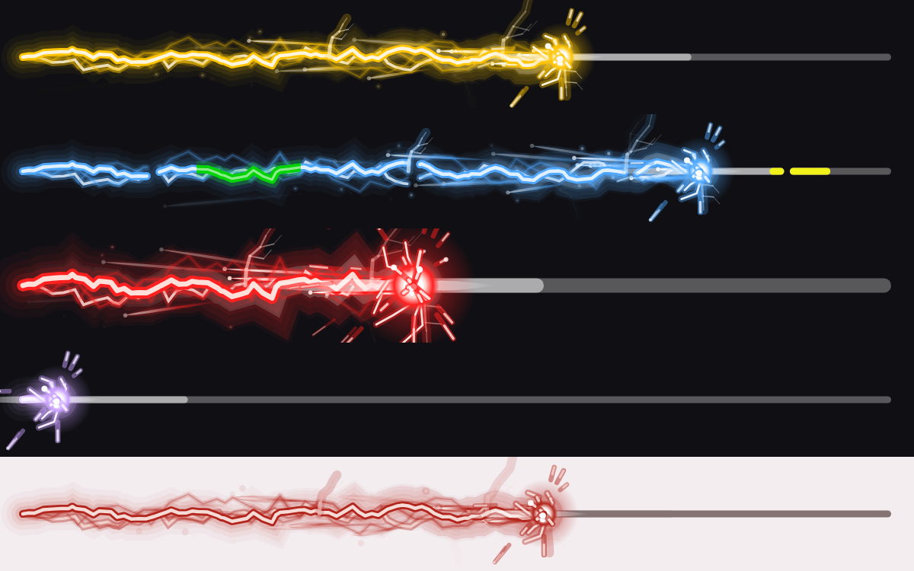
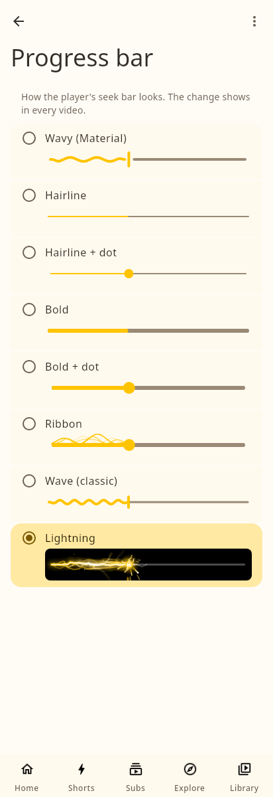

# 146 Lightning streaks, Gold colour scheme, dark theme cards

## 1. Summary
Lightning now has streaks and motes blown back from the head, a hot wake behind it, a flare through it, finer two-scale jaggedness and tapered, twigged forks. New "Gold" colour scheme. Fixed: the colour-scheme cards showed the light theme in a dark app (they asked Compose for the system theme, which answers "light" on Linux; they now follow the theme on screen, including pure black).

Top to bottom: gold; blue with chapters and markers; red while dragging; near the start; light surface.

## 2. Verification
| check | result | verified-by-running vs compile-only |
|---|---|---|
| `:shared:allTests` (762 JVM tests, includes the 4.5:1 contrast and over-video accent checks, now covering Gold) | pass | run |
| `:desktopApp:test` (205 tests; new: streaks, dark cards following desktop and chosen theme, Gold seek colour) | pass | run |
| `:androidApp:compileDebugKotlin` | pass | compile-only |
| Look of the bar and of Gold (home, Customize, progress page) | judged from rendered desktop images, light and dark | run, still images only |
| Drawing cost, CPU raster, 5 bars of 1200x150 px | about 42 ms per frame, up from 27 ms in task 145 (about 8.4 ms per bar) | run; says nothing about GPU cost on a phone |
| Motion, smoothness and battery on a device | NOT RUN | needs the owner |

## 3. Files created/changed
- Lightning: `ui/components/LightningProgress.kt`, `LightningProgressUiTest.kt`.
- Gold: `core/settings/LookSettings.kt`, `ui/theme/Palettes.kt`, `ui/theme/Accent.kt`, `ui/theme/AppTheme.kt`.
- Cards and previews: `ui/screens/CustomizeScreens.kt`, new `ColorSchemeUiTest.kt`.
- This report and its two images.

## 4. Decisions the spec didn't dictate
- Gold's seek bar and watched bar are a fixed bright yellow (`#FFC400`) in both themes: the light theme's primary must be a brownish gold to carry text, which looks muddy over video. Logo, splash and badges still use the primary.
- Gold's dark surfaces use a duller tint than the light ones, to avoid a muddy olive page.
- Progress bar previews now use the player's seek colour, so Classic previews are red (they were black or white).
- The Lightning preview sits on a black strip in both themes.

## 5. Known issues / unverified assumptions
- Lightning is now noticeably heavier to draw (more shapes, and new gradient objects for each streak every frame). If a phone stutters or runs warm, the streak and mote counts are the first thing to cut.
- Light schemes other than Gold and Classic still draw their darker light-theme primary over video (unchanged).
- The cards' fix was reproduced by supplying "desktop is dark" in a test, not on a real GNOME session.
- A backup containing Gold, restored on an older version, was not tried.

## 6. Manual test checklist
1. With the system in dark mode and Theme = System, open Settings > Customize: the colour cards are dark. Switch Theme to Light and back: they follow.
2. Turn on pure black: the cards turn black-based too.
3. Choose Gold in light and in dark: check buttons, chips, navigation and text.
4. With Gold + Lightning, play a video: yellow bolt, streaks flowing back from the head.
5. On the phone, portrait and fullscreen: smoothness, battery warmth, and whether the streaks distract.
6. Pause, then drag: everything freezes, then crackles while dragged.
