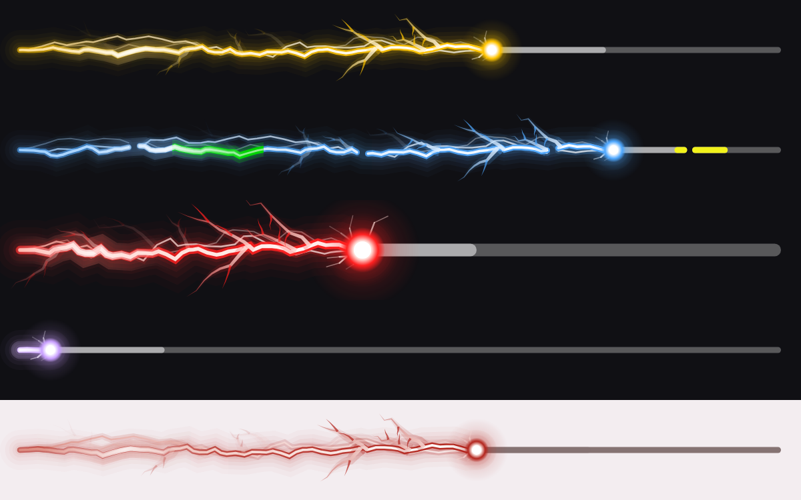
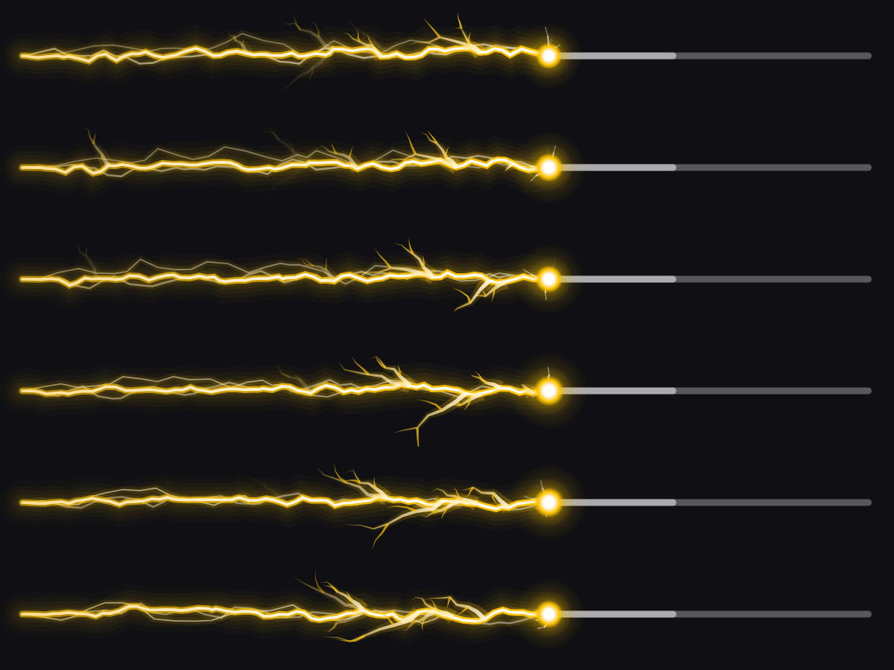

# 147 Lightning reworked: flows back from the playhead

## 1. Summary
Streaks, motes, falling sparks, the lens flare and the forward leader are removed. The playhead is now the source: the whole bolt and two fine filaments stream back from it, writhing slowly, and tapered branches are born at the head, strike out backwards, ride along with the bolt and fade. A few small random forks flicker elsewhere. The head is a calm glowing point with short arcs.

Six frames of one bar, 0.1 s apart (branches travel left):

## 2. Verification
| check | result | verified-by-running vs compile-only |
|---|---|---|
| `:shared:allTests`, `:desktopApp:test` (205 desktop tests) | pass | run |
| New test: over 0.05 s the bolt's shape matches best slid about 5 px towards the start (median of 7 moments) | pass | run |
| `:androidApp:compileDebugKotlin` | pass | compile-only |
| Look | judged from rendered desktop frames | run, frames only |
| Drawing cost, CPU raster, 5 bars of 1200x150 px | about 28 ms per frame (42 ms in task 146, 27 ms in 145) | run; says nothing about GPU cost on a phone |
| Motion, smoothness and battery on a device | NOT RUN | needs the owner |

## 3. Files created/changed
- `ui/components/LightningProgress.kt` (drawing rewritten), `desktopApp/.../ui/LightningProgressUiTest.kt` (streak test replaced by the flow test).
- This report and its two images.

## 4. Decisions the spec didn't dictate
- Flow speed is 105 dp a second, independent of video speed.
- Branches sweep back at a shallow angle and bend towards the bolt; each lives 0.6 to 2.2 s.
- Dragging widens the bolt and adds longer and more branches.

## 5. Known issues / unverified assumptions
- Branches reach about 230 dp back from the head. On a long bar (fullscreen, desktop) the far end has only the flowing bolt, filaments and small random forks.
- Branches pass the bar's 48 dp box by a little while dragging and may be cut at the bottom of the small portrait player.
- Speed, branch count and brightness were tuned from still frames; they may need adjusting once seen moving on the phone.

## 6. Manual test checklist
1. Choose Settings > Customize > Progress bar > Lightning and watch the preview: the flow should clearly run away from the playhead.
2. Play a video in portrait and fullscreen: judge speed, branch density and whether it distracts.
3. Drag the bar: stronger lightning, no jumps in the shape, seek lands correctly.
4. Pause: it freezes; drag while paused: it moves.
5. A video with chapters and SponsorBlock segments: both stay readable.
6. Check smoothness and warmth on the phone over a few minutes with the controls shown.
