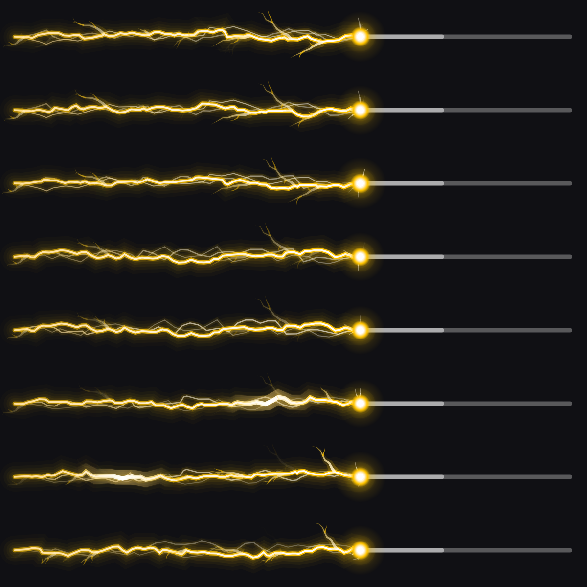

# 148 Lightning strikes instead of flowing

## 1. Summary
Task 147's sliding shape read as flowing water. Nothing slides now: the bolt and filaments hold a shape for an instant and snap to the next, flashing brighter as they do. Direction comes from volleys: about twice a second a strike shoots from the playhead down the bolt, and branches thrown backwards break out behind it, stay where they struck, flicker and die. Small random forks fire out of step with the volleys.

Frames of one bar, 1/15 s apart (a strike travels left in the sixth and seventh):

## 2. Verification
| check | result | verified-by-running vs compile-only |
|---|---|---|
| `:shared:allTests`, `:desktopApp:test` (205 desktop tests) | pass | run |
| New test: the bolt is still within one hold and differs after it (3 moments) | pass | run |
| `:androidApp:compileDebugKotlin` | pass | compile-only |
| Look | judged from rendered desktop frames | run, frames only |
| Drawing cost, CPU raster, 5 bars of 1200x150 px | about 28 ms per frame (28 ms in task 147) | run; says nothing about GPU cost on a phone |
| How it feels in motion, smoothness, battery on a device | NOT RUN | needs the owner |

## 3. Files created/changed
- `ui/components/LightningProgress.kt` (shape and branch timing rewritten), `desktopApp/.../ui/LightningProgressUiTest.kt` (flow test replaced).
- This report and its image.

## 4. Decisions the spec didn't dictate
- Sharp kinks change 11 times a second, the broad bend a third as often; filaments 8 and 6 times.
- A volley every 0.46 s with random delay; the strike travels at 1500 dp a second; branches live 0.25 to 0.75 s.
- Branches crowd towards the playhead and weaken with distance, but now reach the whole bar.

## 5. Known issues / unverified assumptions
- Rhythm and brightness were chosen without seeing it on a phone. The three numbers above are the ones to tune.
- It flickers by design. The brightness changes are small in area, but it was not assessed for light sensitivity; "remove animations" behaviour is still unverified (task 145).

## 6. Manual test checklist
1. Settings > Customize > Progress bar > Lightning: it should read as crackling electricity coming from the playhead, not as something sliding.
2. Play a video in portrait and fullscreen: judge speed (too nervous or too calm) and branch density.
3. Drag the bar: stronger lightning, seek lands correctly.
4. Pause: it freezes; drag while paused: it crackles.
5. Check smoothness and warmth on the phone over a few minutes with the controls shown.
