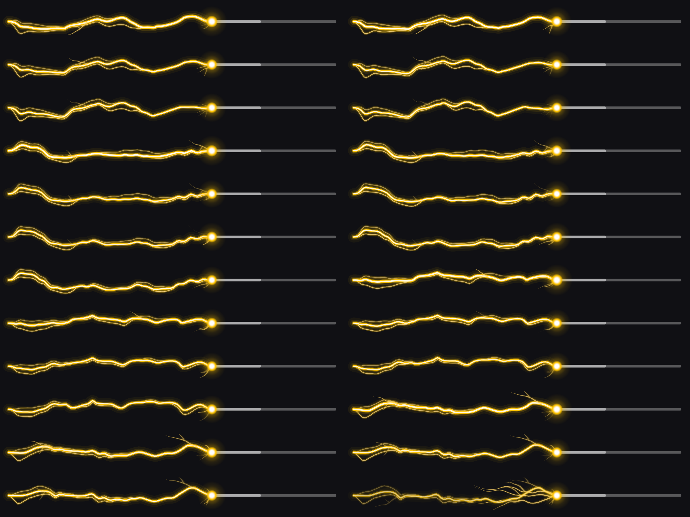

# 149 Lightning motion taken from Tesla coil footage

## 1. Summary
The motion now follows the owner's clip (a Tesla coil arc, 30 fps). One sinuous channel persists and writhes in place, then jumps to a new path; some jumps are preceded by a dim "search" with long filaments fanning from the playhead. The channel is a bundle of strands that part into loops, with a tight glow. Zigzags, volleys and the sliding shape of tasks 147 and 148 are gone.

Consecutive pictures at 30 per second (down the left column, then the right):

## 2. Verification
| measure | footage | seek bar | verified-by-running vs compile-only |
|---|---|---|---|
| Movement between pictures / size of the arc's curls, quartiles (p25, p50, p75) | 0.106, 0.144, 0.213 (364 picture pairs) | 0.086, 0.127, 0.229 (120 pairs) | run |
| Jumps to a new path | about 15 % of picture pairs (67 of 446, includes search phases) | about 12 % (15 of 120) | run |
| How long one path lasts | median 3 to 4 pictures counting search flickers, up to 39 (1.3 s) | set to 0.07 to about 0.9 s, typically 0.2 to 0.3 s | footage measured; bar by construction |
| Curl size / arc length | 0.053 | about 0.012 (limited by the bar's height) | run |

| check | result | verified-by-running vs compile-only |
|---|---|---|
| `:shared:allTests`, `:desktopApp:test` (205 desktop tests; the shape test now checks small steps, occasional jumps and the speed ratio) | pass | run |
| `:androidApp:compileDebugKotlin` | pass | compile-only |
| Drawing cost, CPU raster, 5 bars of 1200x150 px | about 20 ms per frame (28 ms in task 148), and half as many redraws | run; says nothing about GPU cost on a phone |
| How it feels in motion, smoothness, battery on a device | NOT RUN | needs the owner |

Method: 900x640 crops of three wide, still-camera spans of the clip (3.0 s, 12.2 s, 23.0 s), violet pixels traced per column; a jump is a median column movement of at least 4.5 % of the arc's width (on the seek bar: over 2.5 px on a 400 px render, so the two jump rates are only roughly comparable). The seek bar figures come from the white core of desktop renders.

## 3. Files created/changed
- `ui/components/LightningProgress.kt` (drawing rewritten; clock now 30 steps a second), `desktopApp/.../ui/LightningProgressUiTest.kt`.
- This report and its image.

## 4. Decisions the spec didn't dictate
- Colour still follows the accent; the Twilight scheme is the nearest to the violet of the footage.
- The bar never goes dark between paths, unlike the real arc, so progress stays readable: a search only dims it to about half.
- Pictures change 30 times a second even on faster screens.

## 5. Known issues / unverified assumptions
- The curls are only about a quarter as bold relative to length as in the footage; a 48 dp bar has no room for more.
- The clip was assumed to play at real speed.
- Not yet seen moving on a phone.

## 6. Manual test checklist
1. Settings > Customize > Progress bar > Lightning (try Twilight for violet, Gold for yellow).
2. Play a video in portrait and fullscreen and compare the pace with the clip.
3. Drag the bar: bolder arc, more filaments, seek lands correctly.
4. Pause: it freezes; drag while paused: it moves.
5. Chapters and SponsorBlock segments stay readable.
6. Check smoothness and warmth over a few minutes with the controls shown.
